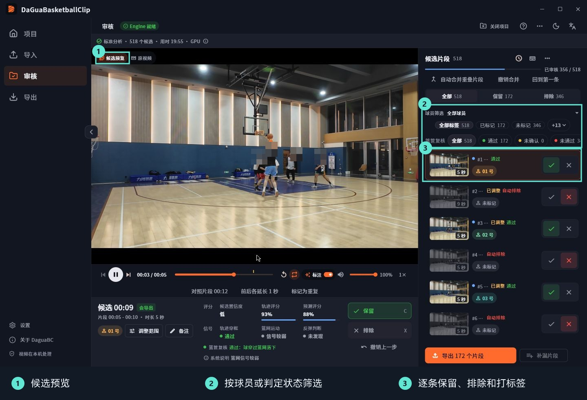
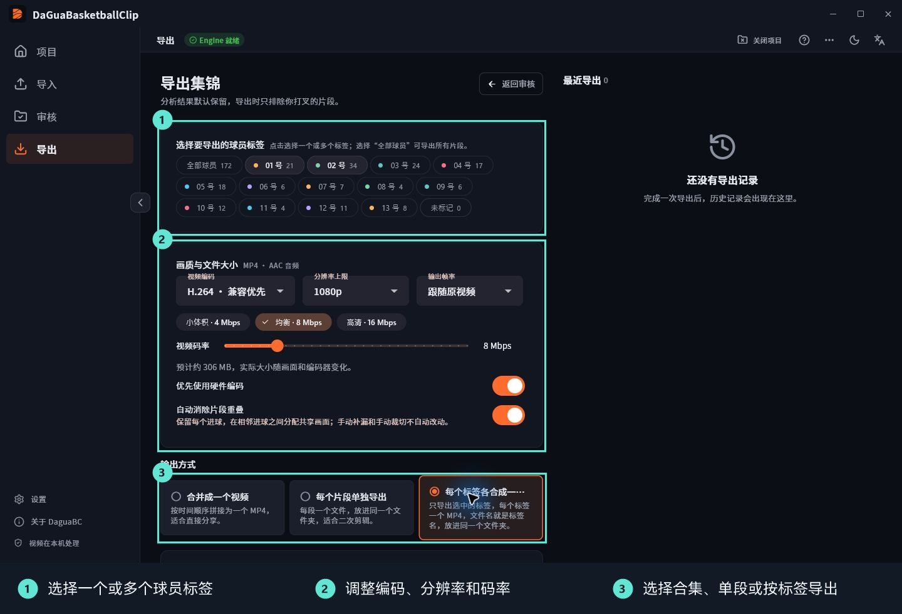

# DaguaBC 大瓜篮球剪辑

面向 Windows 的本地篮球集锦工具。导入固定机位、单篮筐的比赛录像，自动找出候选进球，人工复核、补漏后按球员或标签导出 MP4。

**[下载 0.3.0 Windows x64 安装包](https://github.com/lten44/DaguaBC/releases/download/v0.3.0/DaguaBC-0.3.0-Windows-x64-Setup.exe)** · [发行说明、源码与校验值](https://github.com/lten44/DaguaBC/releases/tag/v0.3.0)

## DaguaBC 在 BHE 基础上做了什么

- **0.3.0 新增竖屏人物居中与轻运镜。** 9:16 竖屏跟球吸收自 BHE v0.1.16。DaguaBC 增加了以出手人为中心的构图，出手后随球轻移向篮筐，入网后稳住。能确认接球后连续持球推进时，镜头会提前把接球人纳入画面。导出前可以预览并手动点选出手人，也可以让单条片段沿用跟球。[BHE v0.1.16](https://github.com/fly7632785/basketball-highlight-editor/releases/tag/v0.1.16)
- **复核、补漏与去重。** 原视频时间轴可以放大，点击标记会定位到对应候选。切换审核筛选时保留播放位置。重分析尽量保留人工审核、手动补漏和球员标签。对同一视频内时间靠近且范围重叠的重复候选做合并，自动排除的重复镜头也会归组。
- **篮筐标定和进球复核。** 机位或篮筐中途偏移，可在视频指定时刻新增标定并重跑该段。在上游检测的基础上结合连续下落、球筐位置和篮网响应，复核部分偏侧出网和证据不足的候选。
- **Windows 长录像处理与导出。** 支持高分辨率素材按需生成 1080p 分析代理，最终从原片导出。DirectML 精扫并行准备画面和推理。支持中文球员名的录入和修改，按多个标签筛选和导出，可设置 MP4 编码、码率、分辨率上限及帧率。

## 特别感谢 BHE 原作者

**特别感谢 Jafir（[@fly7632785](https://github.com/fly7632785)）开源 [Basketball Highlight Editor（BHE）](https://github.com/fly7632785/basketball-highlight-editor)。** DaguaBC 基于 BHE 开发，继承了桌面界面、分析与审核流程以及篮球检测模型。在这个成熟的基础上，我们才能集中精力改进 Windows 上的实际剪球体验。

也谢谢 Jafir 在 [BHE #21](https://github.com/fly7632785/basketball-highlight-editor/issues/21#issuecomment-7090238591) 公开答复模型再分发问题。感谢 BHE 的所有贡献者，以及 [EddyLL06 在上游 PR #18 提供的进球判定改进](https://github.com/fly7632785/basketball-highlight-editor/pull/18)，其中部分同帧检测和篮网响应思路用于本分支。

DaguaBC 提交的 Windows 修复让生成预览图时也能保存审核和球员标签。感谢 Jafir 将它纳入 BHE v0.1.16。[上游 PR #23](https://github.com/fly7632785/basketball-highlight-editor/pull/23)

[English](README.en.md) · [从源码运行](docs/WINDOWS_SOURCE.md) · [更新记录](CHANGELOG.md)

## 使用流程

### 1. 导入录像并标定篮筐

在「项目」里新建项目并选择固定机位、单篮筐录像。导入页的**橙框**覆盖篮筐周围的投篮分析区域，**白框**贴住篮筐下方的篮网。确认后开始分析。录像中途出现篮筐偏移时，可在偏移发生的时间新增标定点。 [橙框示意](apps/desktop/assets/hoop_example/good.png) · [白框示意](apps/desktop/assets/hoop_example/net_good.png)

### 2. 审核候选并给球员打标签

在「候选预览」逐条查看。先筛选未确认的片段，再用右侧的勾或叉保留、排除；点击片段的球员标签可分配或修改球员。

### 3. 在原视频时间轴上补漏

切换到「原视频」后，可以放大时间轴并点击标记，跳到对应时刻。遇到漏球时，定位到进球时刻后点击「补漏片段」，再调整片段范围。打开「标注」可查看已有的篮球轨迹。

### 4. 按球员标签导出集锦

选一个或多个球员标签，设置编码、分辨率和码率，再选择合成一个视频、逐段导出或每个标签各生成一个视频。

想导出竖屏时，在「画面」里选择「竖屏 9:16（人物居中）」。首次使用按提示下载约 3.7 MB 的 YOLOX 人物模型，以后可离线使用。构图窗口里可以检查出手人，拖到正确的出手画面点选球员，或为该片段选择跟球。确认构图后再导出。人物定位只用于这次裁切，不会修改球员标签。[模型来源](docs/MODEL_AND_DATA_LICENSES.md)

以上为 Windows 实机截图，演示素材中的人物面部已打码。分析、审核和导出均在本机运行。

## 源码与许可

DaguaBC 的公开发行采用 [AGPL-3.0](LICENSE)。感谢 Jafir 和 BHE 的所有贡献者，我们保留了上游代码的原版权和 [MIT 许可全文](LICENSES/BHE-MIT.txt)。字体、品牌图形、检测模型和第三方运行依赖按各自的条款提供。[上游署名](NOTICE) · [模型与数据](docs/MODEL_AND_DATA_LICENSES.md) · [第三方说明](docs/THIRD_PARTY_NOTICES.md)
