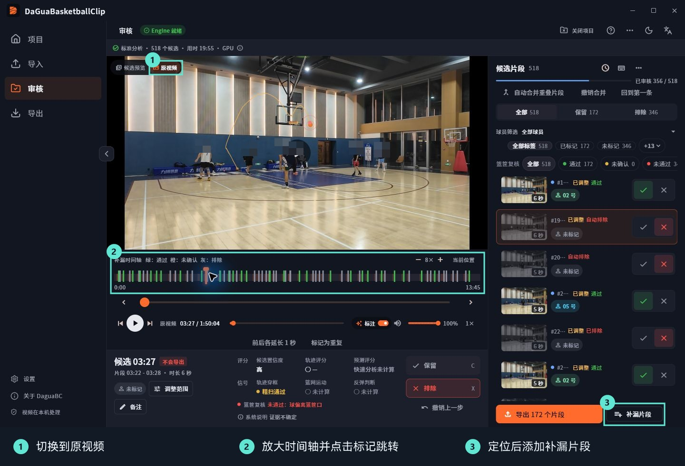

# DaguaBC 大瓜篮球剪辑

面向 Windows 的本地篮球集锦工具。导入固定机位、单篮筐的比赛录像，自动找出候选进球，人工复核、补漏后按球员或标签导出 MP4。

## 特别感谢 BHE 原作者

**特别感谢 Jafir（[@fly7632785](https://github.com/fly7632785)）开源 [Basketball Highlight Editor（BHE）](https://github.com/fly7632785/basketball-highlight-editor)。** DaguaBC 基于 BHE 开发，继承了桌面界面、分析与审核流程以及篮球检测模型。在这个成熟的基础上，我们才能集中精力改进 Windows 上的实际剪球体验。

也谢谢 Jafir 在 [BHE #21](https://github.com/fly7632785/basketball-highlight-editor/issues/21#issuecomment-7090238591) 公开答复模型再分发问题。感谢 BHE 的所有贡献者，以及 [EddyLL06 在上游 PR #18 提供的进球判定改进](https://github.com/fly7632785/basketball-highlight-editor/pull/18)，其中部分同帧检测和篮网响应思路用于本分支。

[English](README.en.md) · [从源码运行](docs/WINDOWS_SOURCE.md) · [更新记录](CHANGELOG.md)

## DaguaBC 的主要改进

- **复核与补漏**。原视频时间轴显示候选标记，可放大、跳转并添加漏掉的进球。切换筛选时保留当前播放位置。
- **篮筐标定与判定**。篮筐位置变化时可在指定时间重新框选。逐帧检查球轨迹与篮网响应处理部分偏侧出网的进球，证据不足时留给人工复核。
- **球员标签与导出**。Windows 支持中文球员名称，可筛选或选择多个标签导出。MP4 可选 H.264 或 H.265、码率、分辨率上限和帧率，实际可用编码器取决于本机环境。
- **长录像处理**。高分辨率录像可选 1080p 分析代理，导出读取原片。支持在满足条件时使用 Windows DirectML，项目可保存在自选目录。

## 使用流程

### 1. 导入录像并标定篮筐

在「项目」里新建项目并选择固定机位、单篮筐录像。导入页的**橙框**覆盖篮筐周围的投篮分析区域，**白框**贴住篮筐下方的篮网。确认后开始分析。录像中途出现篮筐偏移时，可在偏移发生的时间新增标定点。 [橙框示意](apps/desktop/assets/hoop_example/good.png) · [白框示意](apps/desktop/assets/hoop_example/net_good.png)

### 2. 审核候选并给球员打标签

在「候选预览」逐条查看。先筛选未确认的片段，再用右侧的勾或叉保留、排除；点击片段的球员标签可分配或修改球员。

### 3. 在原视频时间轴上补漏

切换到「原视频」后，可以放大时间轴并点击标记，跳到对应时刻。遇到漏球时，定位到进球时刻后点击「补漏片段」，再调整片段范围。打开「标注」可查看已有的篮球轨迹。

### 4. 按球员标签导出集锦

选一个或多个球员标签，设置编码、分辨率和码率，再选择合成一个视频、逐段导出或每个标签各生成一个视频。

以上为 Windows 实机截图，演示素材中的人物面部已打码。分析、审核和导出均在本机运行。

## 源码与许可

此归档对应 DaguaBC **0.2.21**，公开预览面向 Windows x64。应用源码沿用 [MIT](LICENSE)，保留 [上游署名和声明](NOTICE)。字体、品牌图形、检测模型和运行依赖分别遵守各自的许可或使用条件。[模型与数据](docs/MODEL_AND_DATA_LICENSES.md) · [第三方说明](docs/THIRD_PARTY_NOTICES.md)
